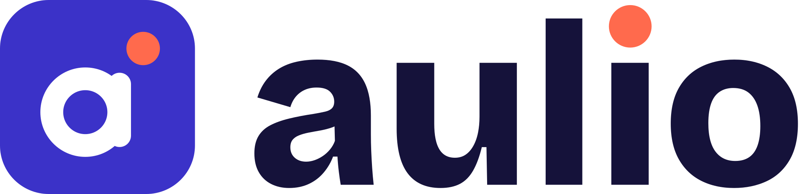

# Marca Aulio

**Aulio by Tikray Labs.** Aulio es el producto; Tikray Labs, la empresa que lo respalda.

## Idea

El símbolo es la **a** de aula (círculo con su trazo) con un **punto coral** arriba a la derecha: el punto que un celular pone sobre una app cuando hay algo nuevo. Es la promesa del producto: el padre se entera sin preguntar. En el logotipo el mismo punto reemplaza el de la **i**.

## Archivos

En `frontend/public/marca/`:

| Archivo | Uso |
|---|---|
| `aulio-horizontal.svg` | Logo principal sobre fondo claro |
| `aulio-horizontal-blanco.svg` | Logo principal sobre fondo oscuro o índigo |
| `aulio-logotipo.svg` / `aulio-logotipo-blanco.svg` | Solo la palabra |
| `aulio-simbolo.svg` | Ícono de app, favicon, foto de perfil |

En código: `Logotipo`, `Simbolo` y `FirmaAulio` de `frontend/src/espacios/comun/Marca.jsx` (el logotipo toma `currentColor`, así sirve en tema claro y oscuro).

## Colores

| Nombre | Hex | Uso |
|---|---|---|
| Índigo Aulio | `#3B32C8` | Principal. Blanco encima: 8.5:1. Color por defecto de un colegio nuevo |
| Tinta | `#15123A` | Texto y fondos oscuros |
| Coral aviso | `#FF6A4D` | Solo el punto y lo nuevo o urgente. No es color de texto sobre blanco (2.8:1) |
| Lavanda | `#ECEBFF` | Fondos suaves, chips |
| Crema | `#FFF6EC` | Fondo cálido en redes e impresos |

Proporción aproximada en piezas de marca: 45 % índigo, 30 % tinta, 15 % lavanda o crema, 10 % coral.

## Tipografía

- **Bricolage Grotesque**: logotipo y titulares (ExtraBold 800), subtítulos (SemiBold 600).
- **Plus Jakarta Sans**: texto (Regular 400, Medium 500, Bold 700). "by Tikray Labs" va en SemiBold 600.

Las dos ya vienen con la app (`@fontsource`) y están en Google Fonts y Canva.

## Reglas

- En textos se escribe **Aulio**; el logotipo siempre en minúscula.
- No estirar, girar, sombrear ni cambiar el color del punto.
- Espacio libre alrededor del logo: la mitad del ancho del símbolo. Mínimo 16 px en pantalla, 8 mm impreso.
- Dentro del sistema **el colegio va primero**: su logo y su color mandan. Aulio solo firma el pie ("aulio by Tikray Labs") y el panel de Tikray Labs.
- Tono: al padre se le habla de usted, con frases cortas y la hora exacta. "Ya no pregunte si llegó. Aulio le avisa."
